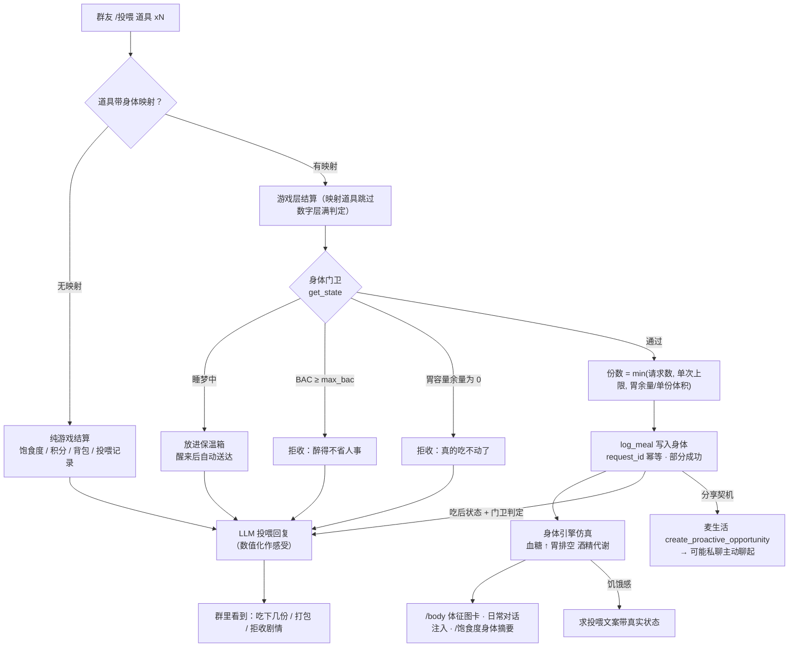

<div align="center">

  <!-- Hero Banner (亮/暗色主题自适应) -->
  <picture>
    <source media="(prefers-color-scheme: dark)" srcset="https://cdn.jsdmirror.com/gh/NetaJuutilainen/maibot-maimai-feed-bot@main/assets/readme/hero-night.svg">
    
  </picture>

  <br/>

  <!-- Badges -->
  <p>
    
    = 1.0.0">
    <a href="LICENSE"></a>
    
    <a href="#交流与反馈"></a>
  </p>

  <p>
    MaiBot 投喂插件 —— <b>签到积分</b> · <b>全局 / 群内双层商店</b> · <b>投喂临时说话风格</b> · <b>定时求投喂</b><br/>
    支持按群隔离数据、自定义商品饱食度与签到积分，可选联动 <b>麦麦身体</b> 与 <b>麦生活</b><br/>
    <sub>基于 <a href="https://github.com/pan-ice/feed-bot">pan-ice/feed-bot</a>（MIT）v1.3.0 改造增强 · 当前版本 <b>2.1.0</b></sub>
  </p>

  <!-- Quick Navigation -->
  <p>
    <a href="#功能特性">功能特性</a> &middot;
    <a href="#效果与菜单">效果与菜单</a> &middot;
    <a href="#命令列表">命令列表</a> &middot;
    <a href="#投喂风格">投喂说话风格</a> &middot;
    <a href="#身体生活联动">身体 / 麦生活联动</a> &middot;
    <a href="#配置说明">配置说明</a> &middot;
    <a href="#安装与排查">安装与排查</a> &middot;
    <a href="#交流与反馈">交流与反馈</a>
  </p>

</div>

> [!TIP]
> 🫀 **1.7.0 新增跨插件联动（可选，默认关闭）**：与 [麦麦身体](https://github.com/ShuangziG/maibot-body-emulator)（生理仿真）和 [麦生活](https://github.com/octmicy/Mai_life)（生活日程）联动——投喂的东西**真的吃进麦麦的身体**，血糖、胃容量、酒精真实变化并反映到群里；道具可按需映射到身体食物词，未映射道具照旧是纯游戏道具。效果、管理命令与完整流程图见 **[身体/生活联动](#linkage)**。

> [!NOTE]
> **与上游 [pan-ice/feed-bot](https://github.com/pan-ice/feed-bot) 的核心差异**：本仓在 1.3.0 基础上加入**投喂临时说话风格**、**按群白名单隔离**等增强（差异明细见文末「更新记录」）。按群隔离开启时（默认），`config.toml` 的 `[[filter.group_admins]]` 就是**唯一白名单**——没列进配置的群完全不启用，把群号从列表删掉即关闭（上游 1.3.0+ 以数据库授权为事实源，语义相反）。关闭只改开关：管理员、饱食度、积分等数据全部保留，加回白名单即原样恢复。

---

<a id="功能特性"></a>
## ✨ 功能特性

- **签到系统**：每日签到获取积分，连续签到有额外奖励；基础积分可由 Bot 管理员私聊调整并持久化
- **积分系统**：记录每个用户的积分余额，支持本群积分排行
- **商店系统**：全局商店（Bot 管理员管理）+ 群内商店（群管理员管理）；`/商店` 每个商品下方都用 `[效果：...]` 标注（无效果的道具显示「无特殊效果」）
- **批量购买/投喂**：`/购买` 和 `/投喂` 支持在道具名后追加数量，单次最多 99 个
- **投喂系统**：用道具投喂 Bot，触发 LLM 生成的趣味回复；饱食度满时无法继续投喂；道具饱食度可由管理员自定义（支持正负值）
- **Bot 属性**：饱食度随投喂增加、随时间衰减，低于阈值时 Bot 会定时在群中求投喂
- **规则查询**：`/投喂规则` 一键查看非管理员可使用的全部指令；`/投喂管理 规则` 查看管理员可用的全部指令
- **投喂临时风格**：道具可配置"投喂后暂时改变 Bot 说话风格"的提示词与时长，吃下后该群 Bot 的回复临时套用此风格

---

<a id="效果与菜单"></a>
## 🖼️ 效果展示与商店菜单

<div align="center">
  <a href="https://cdn.jsdmirror.com/gh/NetaJuutilainen/maibot-maimai-feed-bot@main/docs/images/grid_4x4_2048.jpg">
    
  </a>
</div>

<br/>

<div align="center">
  <a href="https://cdn.jsdmirror.com/gh/NetaJuutilainen/maibot-maimai-feed-bot@main/docs/images/shop_menu.png">
    
  </a>
</div>

上图为一台部署实例的真实菜单（敏感数据已脱敏）：`/商店` 渲染为**图片菜单**，每件道具展示完整效果（风格提示词全文与时长、价格、饱食度），道具再多也不刷屏；WebUI 的 `[shop].render_image` 开关可改回文本菜单，渲染失败时自动回退。

带「清除全部投喂风格」标签的道具（如图中的苹果）吃下后会清空本群全部生效风格，让 Bot 恢复平常语气。想要这样的清除道具，管理员手动 `/投喂管理 群上架 牛奶 5 🥛 喝一口温牛奶，清掉本群全部投喂风格` + `/投喂管理 设置清除效果 牛奶` 即可；或在 WebUI 打开 `[shop].builtin_clear_item` 让每个启用群自动内置 🥛牛奶（**默认关闭**，不改动既有商店数据）。

---

<a id="命令列表"></a>
## 💬 命令列表

### 用户命令（所有成员可用，部分命令仅限群聊）

| 命令 | 说明 |
|------|------|
| `/签到` | 每日签到获取积分 |
| `/积分` | 查看积分余额 |
| `/积分排行` | 查看本群积分排行（仅群聊） |
| `/商店` | 查看可购买道具（每个商品下方标注 `[效果：...]`，无效果的道具显示「无特殊效果」） |
| `/购买 <道具名> [x数量]` | 购买道具放入背包，单次最多 99 个 |
| `/背包` | 查看背包道具 |
| `/投喂 <道具名> [x数量]` | 投喂 Bot，单次最多 99 个（仅群聊） |
| `/投喂记录` | 查看投喂历史 |
| `/饱食度` | 查看当前饱食度（仅群聊） |
| `/状态` | 查看本群当前生效的投喂效果及剩余时间（仅群聊） |
| `/投喂排行` | 查看本群投喂排行（仅群聊） |
| `/投喂规则` | 查看非管理员可使用的全部指令 |

**数量写法示例**：`/购买 面包 x5`、`/购买 面包 *5`、`/购买 面包 ×5`（前缀支持 `x`、`X`、`*`、`×`），或直接空格加数字 `/购买 面包 5`、`/投喂 面包 3`（单次最多 99 个）。购买时积分不足则整批不执行；投喂时库存不足则整批不执行；饱食度容量不足时只消耗实际能吃下的数量。

<details>
<summary><b>🛡️ 展开查看管理员命令列表（Bot 管理员 / 群管理员）与饱食度设置</b></summary>

#### Bot 管理员命令（仅私聊）

| 命令 | 说明 |
|------|------|
| `/投喂管理 全局上架 <名称> <价格> [emoji] [描述] [饱食度N]` | 上架全局道具 |
| `/投喂管理 全局下架 <道具名>` | 下架全局道具 |
| `/投喂管理 全局设置风格 <道具名> <时长分钟> <风格描述>` | 设置全局道具投喂后的临时说话风格 |
| `/投喂管理 全局清除风格 <道具名>` | 清除全局道具的投喂临时说话风格 |
| `/投喂管理 全局设置清除效果 <道具名>` | 把全局道具设为清除型道具（吃下清空该群全部风格） |
| `/投喂管理 签到积分 <数值>` | 设置全局签到基础积分（0-1,000,000，持久化保存） |

#### 管理员命令（群聊中群管理员可用，私聊中 Bot 管理员可用）

| 命令 | 说明 |
|------|------|
| `/投喂管理 规则` | 查看管理员可用的全部指令 |
| `/投喂管理 修改饱食度 <全局\|群> <道具名> <饱食度>` | 修改道具饱食度增加值（需指定全局或群范围） |
| `/投喂管理 积分 <QQ号> <积分值> [群号]` | 覆盖式设置用户积分（直接写入该值，负数按 0 处理；私聊时需指定群号） |
| `/投喂管理 属性 <属性名> <值> [群号]` | 设置 Bot 属性（属性名支持 `satiety` / `饱食度`，私聊时需指定群号） |
| `/投喂管理 重置签到 <QQ号> [群号]` | 重置签到记录（私聊时需指定群号） |
| `/投喂管理 授权 <群号> <QQ号>` | 授权群管理员 |
| `/投喂管理 取消授权 <群号> <QQ号>` | 取消群管理员 |
| `/投喂管理 群列表` | 查看已授权的群及管理员 |

#### 群管理员命令

| 命令 | 说明 |
|------|------|
| `/投喂管理 群上架 <名称> <价格> [emoji] [描述] [饱食度N]` | 上架群内道具 |
| `/投喂管理 群下架 <道具名>` | 下架群内道具 |
| `/投喂管理 设置风格 <道具名> <时长分钟> <风格描述>` | 设置本群道具投喂后的临时说话风格（在哪个群发送就对该群生效） |
| `/投喂管理 清除风格 <道具名>` | 清除本群道具的投喂临时说话风格 |
| `/投喂管理 设置清除效果 <道具名>` | 把本群道具设为清除型道具（吃下清空该群全部风格） |

上架示例：
- `/投喂管理 群上架 面包 10 🍞 好吃的 饱食度10`
- `/投喂管理 群上架 面包 10 🍞 好吃的`
- `/投喂管理 群上架 面包 10`

> 如需设置道具饱食度，请在命令末尾添加“饱食度”三个字和数值，例如 `饱食度10`（不写默认 `+5`）。

#### 自定义商品饱食度

每个道具的饱食度（`satiety_bonus`）表示投喂后饱食度的增减量，支持整数和小数、正数和负数：
- **上架时指定**：在群上架或全局上架命令末尾追加 `饱食度<数值>`，如 `饱食度10`（+10）、`饱食度-5`（-5），不写默认 `+5`。
- **修改已有道具**：`/投喂管理 修改饱食度 <全局|群> <道具名> <数值>`，例如 `/投喂管理 修改饱食度 群 面包 8` 或 `/投喂管理 修改饱食度 全局 面包 12.5`（修改群道具需在群聊中执行；私聊中修改全局道具需 Bot 管理员权限）。

</details>

---

<a id="投喂风格"></a>
## 🎭 投喂临时说话风格

部分道具可以配置"吃下后暂时改变 Bot 说话风格"的效果：投喂成功后，该群的 Bot 回复会在指定时长内套用配置的风格提示词。多个不同道具的效果可同时并存（上限见 `[style]` 配置），并存期间所有风格提示词叠加生效；重复投喂同名道具**时长会叠加**（在剩余时间上继续累加，而不是重置），且单次投喂的数量也参与叠加（投喂 x3 即为 3 倍时长）。用 `/状态` 可随时查看本群生效中的效果与剩余时间。

### 实际效果示例

以本群道具"辣椒"为例（效果时长 30 分钟）：

```text
群管理员：/投喂管理 设置风格 辣椒 30 你现在说话变得火辣又暴躁，一言不合就冒火
群友牛牛：/投喂 辣椒
麦麦：呼——辣、辣死了！……（这一句是"吃后感"，暂不套风格）
群友牛牛：麦麦，今晚吃烤串不？
麦麦：吃吃吃就知道吃！吃，必须吃，不吃辣的人生没有意义！多点几份，我先替你们尝尝辣度！（风格生效中）
群友牛牛：明天天气怎么样呀？
麦麦：我怎么知道！……预报说晴、暴晒，出门记得打伞，别把我晒成辣椒干！（风格生效中）
（30 分钟后）
麦麦：「辣椒」效果已失效
```

叠加与清除（清除用清除型道具"牛奶"）：

```text
群管理员：/投喂管理 群上架 牛奶 5 🥛 温牛奶，清掉所有投喂风格
群管理员：/投喂管理 设置清除效果 牛奶    → 把"牛奶"设为清除型道具
群友牛牛：/投喂 奶茶
群友牛牛：/投喂 辣椒 x3   → "辣椒"时长叠加为 30×3 分钟，慵懒+暴躁两个效果并存生效
群友牛牛：/状态           → 查看生效中的效果与各自剩余时间
群友牛牛：/购买 牛奶
群友牛牛：/投喂 牛奶      → 清空本群全部生效风格，麦麦恢复平常语气
```

> [!TIP]
> 也可以在 WebUI 打开 `[shop].builtin_clear_item`，让每个启用群自动内置 🥛牛奶（默认关闭）。风格只注入说话风格，不影响 Bot 的行为逻辑与工具调用；吃下道具那一句"吃后感"不套风格，从下一句正常对话开始生效。

<details>
<summary><b>📖 展开查看风格设置指令与机制说明</b></summary>

**群道具（群管理员，在群内发送）：**
- `/投喂管理 设置风格 <道具名> <时长分钟> <风格描述>`
- `/投喂管理 清除风格 <道具名>`
- `/投喂管理 设置清除效果 <道具名>`

例：`/投喂管理 设置风格 辣椒 30 你现在说话变得火辣又暴躁` → 本群吃下"辣椒"后 30 分钟内套用该风格。

**全局道具（Bot 管理员，私聊）：**
- `/投喂管理 全局设置风格 <道具名> <时长分钟> <风格描述>`
- `/投喂管理 全局清除风格 <道具名>`
- `/投喂管理 全局设置清除效果 <道具名>`

**规则说明**：
- 风格提示词仅注入 replyer 的说话风格，不影响 Bot 的行为逻辑与工具调用
- 时长单位为分钟（≥1），效果按群作用
- 多个不同道具的效果可并存，并存数量上限由 `[style].max_active_effects` 控制（默认 3）；达到上限后再喂不同道具，本次风格不生效，喂同名道具则时长叠加
- 同名道具重复投喂时，新时长**叠加**到该效果剩余时间上（例：剩余 20 分钟再喂 30 分钟 → 剩余 50 分钟）；单次投喂数量也参与叠加（x3 即 +3 倍时长）
- `/状态` 可查看本群当前生效的全部效果及各自剩余时间（永久效果显示"永久"）
- 风格到期时，若 `[style].expire_notice` 开启（默认开启），会在群内发送「XX」效果已失效 提示
- 清除型道具：用「设置清除效果」命令把道具设为"解药"，吃下后清空该群当前全部生效风格（不产生新效果、不占上限）；想改回普通道具，再跑 `清除风格 <道具名>` 即可
- 清除道具可手动上架（`群上架` + `设置清除效果`），或在 WebUI 开启 `[shop].builtin_clear_item` 自动为每个启用群内置 🥛**牛奶**（默认关闭，不改动既有商店数据）
- 效果为内存态：Bot 重启后未到期的风格会失效
- 吃下道具那一刻的"吃后感"回复不走该风格，从下一句正常对话开始生效

</details>

---

<a id="linkage"></a>
<a id="身体生活联动"></a>
## 🫀 麦麦身体 / 麦生活联动（可选，1.7.0 新增）

与 [maibot-body-emulator](https://github.com/ShuangziG/maibot-body-emulator)（麦麦身体，v1.2.0+）和 [octmicy/Mai_life](https://github.com/octmicy/Mai_life)（麦生活）跨插件联动：**投喂的东西真的吃进麦麦的身体**，血糖、胃容量、酒精、心情全部真实变化，并在群聊里反映出来。

**全部默认关闭**，`config.toml` 的 `[linkage]` 段开启；关闭时行为与旧版完全一致：

```toml
[linkage]
body_enabled = true       # 联动麦麦身体（需服务器已装 maibot-body-emulator v1.2.0+）
mai_life_enabled = true   # 联动麦生活（投喂后可能主动私聊聊起这事；求投喂文案参考真实状态）
max_servings_per_feed = 3 # 单次投喂最多进身体的份数（防灌爆，多余份数文案打包圆场）
max_bac = 0.25            # BAC 拒收阈值（醉得不省人事后不再收酒；0 = 不设限）
meal_valence = 10.0       # 投喂后给一点好心情（body 1.3.0+；0 = 关闭）
pending_feed_poll_seconds = 300  # 睡眠待喂队列检查间隔（秒）
pending_feed_expire_hours = 8.0  # 待喂超时退回背包
```

### 联动效果一览

| 效果 | 说明 |
|------|------|
| **真吃** | 投喂带映射的道具 → `log_meal` 写进身体：血糖升高、胃慢慢排空、酒精按固定速率代谢 |
| **真醉** | 连续投喂酒类道具，BAC 叠加 → 她说话带醉意、反应迟钝，随时间醒酒 |
| **真饿** | 身体按生理规律消化，饿了以后求投喂文案带上真实饥饿感/血糖 |
| **门卫** | 睡着时放进保温箱、醒来自动送达；胃装不下减量、BAC 超标拒收——规则决定，LLM 只负责把结果讲成剧情 |
| **心情** | 投喂成功顺带一点正向 valence（body 1.3.0+），6 分钟自然回落；只动情绪曲线，不改生理数值 |
| **可见** | 投喂回复附带吃后状态、`/饱食度` 附带身体摘要行；身体侧另有 `/body` 体征图卡与日常对话注入 |
| **社交** | 投喂成功给麦生活塞分享契机 → 她可能之后主动私聊聊起「今天被投喂的奶茶」 |

**管理命令（群管理员·群内 / Bot 管理员·私聊）**：

```text
/投喂管理 映射 <道具名> [食物词] [meal|snack|drink] [每份克数]   # 食物词留空时返回身体词表候选
/投喂管理 解除映射 <道具名>                                      # 恢复纯游戏道具
/投喂管理 映射列表                                               # 全部道具映射现状 + ✓/✗ 解析校验
```

**WebUI 管理页（1.8.0+）**：WebUI 侧边栏 →「麦麦要吃那个！ → 身体联动管理」——映射总览表（行内编辑/清除/✓✗ 校验/词表候选）、**一键新建联动道具**（上架+映射一个表单）、定食组合校验、身体实时状态。命令与页面效果一致，随选。

**映射与省道具模式**：
- **映射语义**：只有映射过的道具才会进身体（未映射 = 纯游戏道具，零影响）；食物词按身体侧 311 种食物 + 473 别名解析（写中文即可，如 `米饭` / `啤酒`）；类型 `snack`（默认）/`drink`（饮品）/`meal`（整桌饭，引擎会按餐段食谱补全配菜）。投喂路径不自动用 `meal`，保证「投喂什么就吃什么」。
- **省道具模式（1.7.1+）**：映射道具投喂**先问身体再扣道具**——BAC 超标 / 胃满时整单礼貌拒绝（道具不消耗）；睡着时先入待喂队列，身体真正清醒后自动送达，超时未送达会退回道具；通过则只消耗身体实际接受的份数，剩余留背包。可选「每份克数」做小份（如啤酒 250g = 半杯，同一道具能喂更多口才饱）；食物词支持**逗号组合**配定食（如 `米饭,猪肉,青菜`），一次投喂吃下整组食材、营养均衡。`/商店` 里映射道具带 `[🫀 身体联动：…]` 标注。



> [!NOTE]
> 身体是**全局一副**，任何群的映射投喂都喂同一个身体（跨群共同养成）；每群的饱食度数字是独立的玩法层（本群投喂热度），与身体状态互不覆盖。所有联动调用失败一律静默降级——身体没装 / 没开 / 超时时，投喂本身完全照常。

---

<a id="配置说明"></a>
## ⚙️ 配置说明

编辑插件目录下的 `config.toml` 进行配置，修改后支持热重载（也支持在 WebUI 面板直接修改）。

### 自定义签到积分

签到积分 = `基础积分 + min((连续天数-1) × 递增奖励, 奖励上限)`

- **方式一（推荐）**：Bot 管理员私聊执行 `/投喂管理 签到积分 <数值>`（范围 `0 ~ 1,000,000`，持久化保存，优先于 `config.toml` 中的 `base_points`）。
- **方式二**：编辑 `config.toml` 的 `[sign]` 段（`base_points=10`、`consecutive_bonus=5`、`max_consecutive_bonus=50`，连续第 11 天达上限 60）。

<details>
<summary><b>📋 展开查看完整 config.toml 各配置节明细（[plugin] / [admin] / [bot_attr] / [filter] / [llm] / [shop] / [style]）</b></summary>

#### `[plugin]` 插件基础

| 配置项 | 类型 | 默认值 | 说明 |
|--------|------|--------|------|
| `enabled` | bool | `true` | 是否启用投喂插件 |
| `config_version` | string | `"2.1.0"` | 配置版本号，与插件版本保持一致 |

#### `[admin]` 管理员

| 配置项 | 类型 | 默认值 | 说明 |
|--------|------|--------|------|
| `admin_users` | list[str] | `[]` | Bot 管理员 QQ 号列表，拥有所有管理员权限 |

```toml
[admin]
admin_users = ["123456789", "987654321"]
```

#### `[sign]` 签到

| 配置项 | 类型 | 默认值 | 说明 |
|--------|------|--------|------|
| `base_points` | int | `10` | 每次签到获得的基础积分 |
| `consecutive_bonus` | int | `5` | 连续签到每天额外递增的奖励积分 |
| `max_consecutive_bonus` | int | `50` | 连续签到奖励积分上限 |

#### `[bot_attr]` Bot 属性

| 配置项 | 类型 | 默认值 | 说明 |
|--------|------|--------|------|
| 初始饱食度（`initial_satiety`） | float | `80.0` | 初始饱食度（0-100） |
| 饱食度衰减量（`satiety_decay_rate`） | float | `0.5` | 饱食度每小时衰减量 |
| 求投喂阈值（`seek_feed_threshold`） | float | `30.0` | 饱食度低于此值触发求投喂 |
| 求投喂冷却时间（`seek_feed_cooldown`） | float | `7200.0` | 求投喂消息冷却时间（秒，默认 2 小时） |
| 安静时段（`quiet_hours`） | string | `"23:00-08:00"` | 求投喂安静时段，格式 `HH:MM-HH:MM`（24 小时制），该时段内不发送求投喂消息；留空则不限制 |
| 求投喂消息（`seek_feed_messages`） | list[str] | (20 条默认消息) | 求投喂消息列表，随机选择一条发送（LLM 开启时优先用 LLM 生成） |

属性机制：饱食度上限 100，满饱食度无法继续投喂；每小时衰减 `satiety_decay_rate`；所有数据（饱食度、积分、签到、背包、投喂记录）均**按群隔离**，私聊管理员命令需额外指定群号。

#### `[filter]` 群配置（按群隔离，默认开启）

> 只有列在 `group_admins` 里的群才会启用投喂插件。不在列表里的群一律不响应；**把某个群从列表里删掉，配置热重载后该群立即关闭**。关闭 `group_admins_whitelist` 可退回旧行为。

| 配置项 | 类型 | 默认值 | 说明 |
|--------|------|--------|------|
| `group_admins_whitelist` | bool | `true` | 按群隔离总开关。`true` 时 `group_admins` 就是**唯一白名单**（列表外的群关闭、数据保留）；`false` 时回到 1.3.0 旧行为（仅首次初始化，之后以数据库和 `/投喂管理 授权` 为准）。 |
| `group_admins` | list[GroupAdminEntry] | `[]` | 白名单群及其管理员（`group_id`、`admin_users` 多个用逗号、空格或 `\|` 分隔）。 |

```toml
[filter]
# true（默认）= 下面的 group_admins 就是唯一白名单
group_admins_whitelist = true

[[filter.group_admins]]
group_id = "123456789"
admin_users = "111, 222"

[[filter.group_admins]]
group_id = "987654321"
admin_users = "333 | 444"
```

> 白名单模式下 `/投喂管理 授权 <群号> <QQ号>` 只会往该群管理员列表加人，**不会**把没列在 `group_admins` 里的群打开；要启用某个群必须将其群号加进 `config.toml`。

#### `[llm]` LLM 回复

| 配置项 | 类型 | 默认值 | 说明 |
|--------|------|--------|------|
| `enabled` | bool | `true` | 是否使用 LLM 生成投喂回复（关闭则使用 `fallback_reply`） |
| `model` | string | `"replyer"` | **模型任务名**（对应 `model_config.toml` 的 `[model_task_config.X]`，如 replyer/planner/utils）。填具体模型名会报「未找到名为 X 的模型」 |
| `temperature` | float | `0.8` | 生成温度，越高越随机（0.0-2.0） |
| `max_tokens` | int | `2000` | 单次回复最大输出 token 数（**含 reasoning 思考 token**）。推理模型设太小会被截断并退回兜底文案（建议 1500-4000） |
| `timeout_seconds` | float | `120.0` | LLM 生成最长等待时间（秒，建议 60-150，上限 600；插件已通过 `rpc_timeout_ms` 放宽宿主默认 30 秒限制，不要超过命令本身的 180 秒派发超时） |
| `fallback_reply` | list[str] | (10 条默认回复) | LLM 不可用时的兜底回复，随机抽选一条 |

#### `[shop]` 商店 & `[style]` 投喂风格

| 配置节 | 配置项 | 类型 | 默认值 | 说明 |
|--------|--------|------|--------|------|
| `[shop]` | `render_image` | bool | `true` | `/商店` 渲染为图片菜单；关闭或失败时自动回退文本 |
| `[style]` | `max_active_effects` | int | `3` | 同一群同时生效的投喂风格数量上限 |
| `[style]` | `expire_notice` | bool | `true` | 风格失效时是否在群内发送「XX」效果已失效 提示 |

</details>

---

<a id="安装与排查"></a>
## 🚀 安装与故障排查

### 快速安装

1. 将插件目录放置到 MaiBot 的 `plugins/` 目录下（或通过插件中心安装）
2. 重启 MaiBot，或通过 WebUI 插件管理刷新 / 重载插件
3. 首次启动自动生成插件目录下的 `config.toml`
4. 在 `config.toml` 中配置 `[admin].admin_users`（Bot 管理员）和 `[[filter.group_admins]]`（授权群）后即可使用

### 常见故障排查

| 现象 | 排查方式 |
|------|----------|
| 群内命令回「群未授权」 | 按群隔离默认开启：群号必须列在 `config.toml` 的 `[[filter.group_admins]]` 里，改完等配置热重载（或重载插件） |
| `/投喂` 回的是固定几条兜底文案 | LLM 调用失败：检查 `[llm].model` 填的是**任务名**（如 `replyer`）而非具体模型名；推理模型把 `[llm].max_tokens` 提到 1500-4000；模型慢把 `[llm].timeout_seconds` 调到 60-150 |
| 日志报「未找到名为 X 的模型」 | `[llm].model` 填成了模型名，改成 `model_config.toml` 里 `[model_task_config.X]` 的任务名 |
| 饱食度不动 / 一直不求投喂 | 检查 `[bot_attr]`：阈值 `seek_feed_threshold`、冷却 `seek_feed_cooldown`、安静时段 `quiet_hours`（默认 23:00-08:00 不发送） |
| 升级后积分/背包数据"消失" | 数据目录已规范化到 `data/plugins/maibot.maimai-feed-bot/`，首次加载自动搬迁；看启动日志有没有「数据目录已规范化」，若新目录为空，检查旧插件目录下 `data/feed_bot.db` 是否还在 |
| 插件没加载 / WebUI 配置页空白 | 看宿主日志的 manifest 校验输出（字段/区间错误会点名）；`_manifest.json` 的改动需重启宿主生效 |
| WebUI 插件详情页没有更新日志 | 插件根目录需有 `CHANGELOG.md`（按固定文件名读取），发版时同步更新 |

<details>
<summary><b>🗂️ 展开查看：数据存储、手工验证、权限体系、项目结构与更新记录</b></summary>

#### 数据存储
- 所有数据保存在宿主分配的持久数据目录 `data/plugins/maibot.maimai-feed-bot/` 下的 `feed_bot.db`（SQLite，自动创建），跨重启保留；数据按群号前缀严格隔离。
- 从 1.4.x 及更早版本升级时，首次加载会自动把旧位置（插件目录内 `data/feed_bot.db`）搬迁到新目录，旧文件保留作回滚保险。

#### 手工验证步骤
本仓库不含自动化测试（回归用例仅本地维护，不随仓库分发），部署后可按以下顺序手工验证：
1. 重载插件，日志出现 `投喂插件已加载` 与 `投喂插件当前启用群（白名单）：…`
2. 群内 `/签到` → `/商店` → `/购买 面包` → `/投喂 面包` 走通一轮
3. `/状态` 查看生效中的风格；把测试群从白名单删掉、热重载后，该群命令应回复「群未授权」

#### 权限体系

| 权限级别 | 识别方式 | 可执行操作 |
|---------|---------|-----------|
| Bot 管理员 | `config.toml` 中 `admin_users` 列表 | 所有管理员命令 + 全局商店管理 + 全局签到积分设置 + 群内商店管理 + 授权群管理员 |
| 群管理员 | 通过配置 `group_admins` 或 `/投喂管理 授权` 设置 | 本群的群内商店管理（上架/下架群内道具）+ 授权/取消授权本群管理员 |
| 普通用户 | 默认 | 签到、查看积分、购买、投喂、查看规则等用户命令 |

#### 项目结构

| 文件 | 说明 |
|------|------|
| `plugin.py` | 插件入口与生命周期管理 |
| `commands_user.py` | 用户命令（签到、积分、商店、购买、背包、投喂、规则等） |
| `commands_admin.py` | 管理员命令（商店管理、积分调整、签到设置、授权管理等） |
| `db.py` | SQLite 异步数据库层 |
| `loops.py` | 定时任务（饱食度衰减、求投喂）与 LLM 回复生成 |
| `config.py` | 配置模型定义 |
| `utils.py` | 工具函数与路径常量 |

#### 更新记录
完整变更记录见 [CHANGELOG.md](CHANGELOG.md)（WebUI 插件详情页同样按该文件展示）。
- **2026-10-18（本地版 1.4.0，fork 基线）**：新增按群隔离——`[[filter.group_admins]]` 即唯一白名单，列表外的群完全不启用、热重载即生效；授权命令不再自动开门。
- **2026-09-19（本地合并版）**：合并上游 1.3.0（群授权持久化到数据库 + LLM 任务路由自适应），本地功能全部保留。
- **更早（2026-08）**：投喂临时风格系统、LLM 稳定性修复、求投喂原子抢占、`/投喂规则`、签到积分设置等。

</details>

---

<a id="交流与反馈"></a>
## 💬 交流与反馈

<div align="center">

<table>
  <tr>
    <td align="center" width="50%">
      <br/>
      <b>🐧 QQ 交流与插件测试群</b><br/><br/>
      <br/><br/>
      群号：<code>556461602</code><br/>
      <sub>插件使用交流 · 配置答疑 · 新版合成测试体验</sub>
      <br/><br/>
    </td>
    <td align="center" width="50%">
      <br/>
      <b>🐛 问题反馈与功能建议</b><br/><br/>
      <a href="https://github.com/NetaJuutilainen/maibot-maimai-feed-bot/issues">前往 GitHub Issues 提交</a><br/><br/>
      <sub>遇到 Bug 建议附带复现步骤与对应日志片段</sub>
      <br/><br/>
    </td>
  </tr>
</table>

</div>

---

## 📄 许可证

MIT License

基于 [pan-ice/feed-bot](https://github.com/pan-ice/feed-bot)（Copyright (c) 2026 磐冰 / pan-ice，MIT License）v1.3.0 改造，改动部分 Copyright (c) 2026 NetaJuutilainen。许可证全文见 [LICENSE](LICENSE)。
